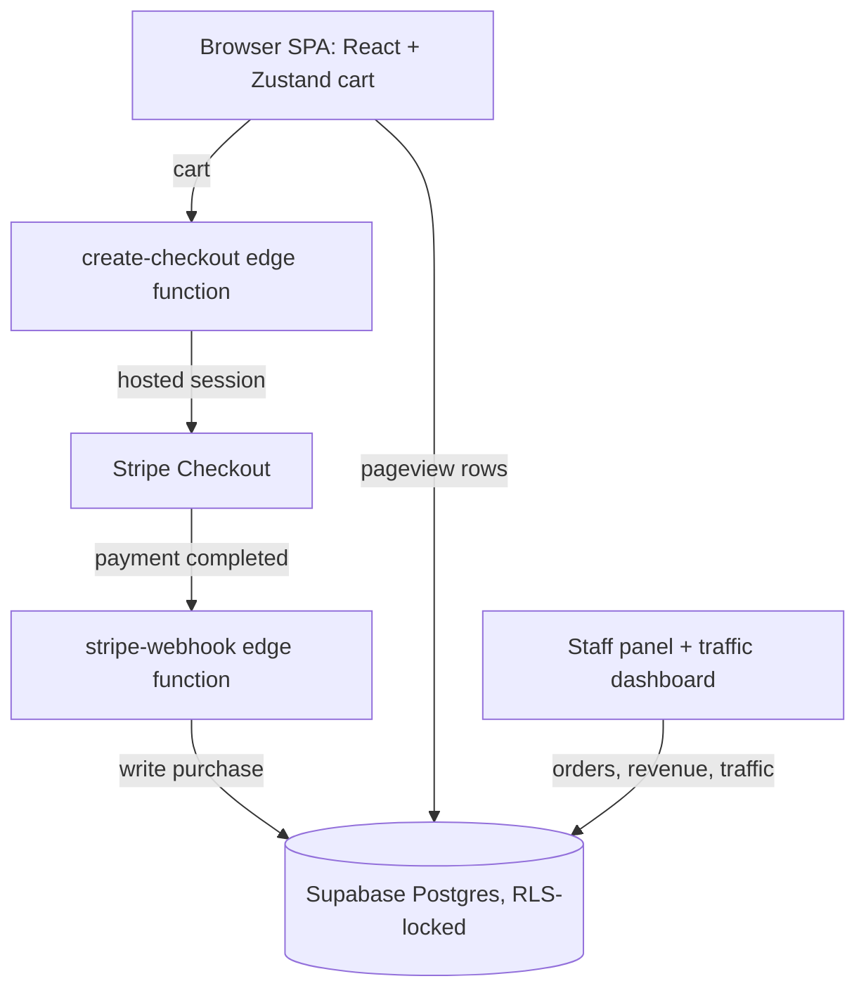

<p align="center">
  
</p>

<h1 align="center">Speedway 146</h1>

<p align="center">
  <b>Go-kart racing and family entertainment in Baytown, TX.</b>
</p>
<p align="center">
  The storefront and back office for Speedway 146. Book races, packages, and parties online.<br />
  Live at <a href="https://baytowngokarts.com">baytowngokarts.com</a>.
</p>

<p align="center">
  
  
  
  
  
  
  
</p>

<br />

## Why Speedway 146

A track's website usually stops at hours and a phone number. This one sells the product: ticket bundles, double-seater packages, and party rentals go into a cart and out through Stripe Checkout, while the same app doubles as the staff back office for orders, revenue, and site traffic. Pricing is never trusted to the browser: every cart is re-priced server-side before a payment session exists.

<table width="100%">
  <tr>
    <td width="50%" valign="top">
      <h3 align="center">Server-authoritative pricing</h3>
      <p align="center">A Supabase edge function re-prices every line against a canonical price map, applies tax, fees, and the group discount, then builds the Stripe session. Totals cannot be tampered with client-side.</p>
    </td>
    <td width="50%" valign="top">
      <h3 align="center">Back office included</h3>
      <p align="center">An authenticated staff panel for orders and revenue plus a live traffic dashboard, both reading straight from Postgres behind row-level security.</p>
    </td>
  </tr>
</table>

<br />

> The repository is named `baytowngocarts-com` for historical reasons. The live product is **Speedway 146**, served from `baytowngokarts.com`.

## Stack

| Layer         | Technology                                                            |
| :------------ | :-------------------------------------------------------------------- |
| UI            | React 18 + React Router 7                                             |
| Build & dev   | Vite 6                                                                |
| Styling       | Tailwind CSS 3 over CSS custom properties (`src/styles/Theme.css`)    |
| Type          | Bebas Neue and Barlow, self-hosted from `public/fonts/`               |
| Cart state    | Zustand                                                               |
| Animation     | `motion` 12, plus `src/lib/reveal.js` for scroll reveals              |
| WebGL effects | `ogl`: the particle fields behind the dark sections                   |
| Backend       | Supabase (Postgres + RLS, Deno edge functions)                        |
| Payments      | Stripe Checkout via Stripe Connect                                    |
| Analytics     | `site_traffic` table, written by a cookieless beacon (ipapi.co geo)   |
| Hosting       | Vercel (prerendered routes, account-route rewrites, security headers) |

## Getting started

```bash
npm install
npm run dev           # Vite dev server
npm run build         # client and server bundles, then a document per indexed route
```

The Supabase client is built on first use and throws if it is not configured, so two variables are required before anything reaches the database:

| Variable                 | Purpose                                          |
| :----------------------- | :----------------------------------------------- |
| `VITE_SUPABASE_URL`      | Supabase project URL.                            |
| `VITE_SUPABASE_ANON_KEY` | Supabase publishable key for the browser client. |

The edge functions read their own secrets from the Supabase project: `STRIPE_SECRET_KEY`, `STRIPE_CONNECTED_ACCOUNT_ID`, `STRIPE_WEBHOOK_SECRET`, and `SUPABASE_SERVICE_ROLE_KEY`.

### Scripts

| Script                 | Does                                           |
| :--------------------- | :--------------------------------------------- |
| `npm run dev`          | Start the Vite dev server.                     |
| `npm run build`        | Build, then prerender every indexed route.     |
| `npm run preview`      | Serve the production build locally.            |
| `npm run lint`         | Lint with ESLint.                              |
| `npm run format`       | Rewrite the tree to the Prettier config.       |
| `npm run format:check` | Report formatting without writing; CI runs it. |

## Architecture



## How it works

- **Products are generated, not hand-listed.** `src/lib/stripe-config.js` builds the catalog from small tier tables (single-kart bundles of 1/4/8/15/25/35/50 tickets, double-seater bundles of 1/2/4/6, and party packages), deriving ids, price ids, labels, and per-race rates.
- **Checkout is validated server-side.** `create-checkout` compares each client price against the canonical map and rejects mismatches, then applies a 4% + $0.30 transaction fee, a 1% platform fee, 8.25% Texas sales tax, and a 10% group discount at 15 or more tickets.
- **Two writers, one order row.** `stripe-webhook` verifies the Stripe signature and writes the order into `purchases` with the service-role key. The success page writes the same order from the browser, which is what puts it in front of a buyer who lands back before Stripe's post has been delivered. `stripe_session_id` is unique, so whichever arrives second is refused by the database rather than doubling the order. Either writer numbers it `SPW146-YYYY-NNNNNN`.
- **Every route ships as a document.** `scripts/prerender.js` renders each indexed route through `src/entry-server.jsx` after the Vite build and writes its markup and head into a file of its own, so a crawler is served the page rather than an empty shell. `src/routes.js` is the one table the client router, the build-time render and the prerender step all read.
- **Two independent analytics layers.** `useTraffic` logs a row per customer-facing page view (staff routes excluded) with user agent, referrer, screen size, and IP geolocation, and feeds the site's own `/traffic` page; a hosted tracker script attached on load reports the same visits to TaylorURL's shared collector. Browser errors travel a third path, to the reporting endpoint behind taylorurl.com/status.
- **One file owns the palette.** Every Tailwind color maps to a CSS custom property in `Theme.css`, so the asphalt / race-red / caution system is a single-file edit. The canvas and WebGL effects read the same properties at runtime through `src/lib/tokens.js`.
- **Each route declares its own head.** A page exports a `metadata` object next to its markup, and `RouteMeta` writes the title, description, canonical, share card and a JSON-LD graph: `WebSite`, `LocalBusiness` with hours and address, `BreadcrumbList`, and `Product` nodes generated from the Stripe catalog.

## Project structure

```
baytowngocarts-com/
├── public/
│   ├── images/                Venue photos, logo, share card, waiver PDFs
│   ├── fonts/                 Self-hosted Bebas Neue and Barlow subsets
│   ├── robots.txt, sitemap.xml, llms.txt
│   └── release.json
├── supabase/
│   ├── config.toml            per-function JWT settings
│   ├── functions/             create-checkout, stripe-webhook (Deno)
│   └── migrations/            the schema, as applied
├── src/
│   ├── components/            common UI, marketing sections, pricing cards, forms,
│   │                          reactbits (WebGL/motion effects)
│   ├── pages/                 Home, Pricing, Cart, Success, StaffPanel, Traffic, ...
│   ├── layouts/               MainLayout: header, footer, pageview logging
│   ├── routes.js              The one route table, read by router, build and prerender
│   ├── main.jsx               Browser entry: attaches to a prerendered document, renders into an empty one
│   ├── entry-server.jsx       Build-time render entry (react-dom/server)
│   ├── hooks/                 useCart (Zustand), useAuth, useAdmin, useTraffic, and the small view hooks
│   ├── lib/
│   │   ├── stripe-config.js   Ticket tiers, packages, price ids
│   │   ├── pricing.js         Price-string parsing helpers
│   │   ├── format.js          Cent / dollar display formatting
│   │   ├── images.js          Responsive source sets for the venue photos
│   │   ├── reveal.js          Fades a section in as it is scrolled to
│   │   ├── chunk-recovery.js  Reloads once when a stale chunk 404s after a deploy
│   │   ├── supabase.js        Shared Supabase client
│   │   ├── tokens.js          Reads palette tokens for the canvas effects
│   │   └── content/           Hero, gallery, FAQs, testimonials, business info,
│   │                          and the per-route SEO helpers
│   ├── index.css              Element defaults, reveal states, and the shared utilities
│   └── styles/                Theme.css design tokens, fonts.css face declarations
├── scripts/
│   ├── calver.js              Moves the CalVer version across the manifests
│   └── prerender.js           Renders the static routes after the Vite build
└── vercel.json                SPA rewrites, security headers, caching
```

## License

Copyright (c) 2026 TaylorURL LLC. All rights reserved. See [LICENSE.md](LICENSE.md).

<br />

<p align="center">
  <sub>Built by <a href="https://taylorurl.com">TaylorURL</a>, custom sites for local businesses.</sub>
</p>
